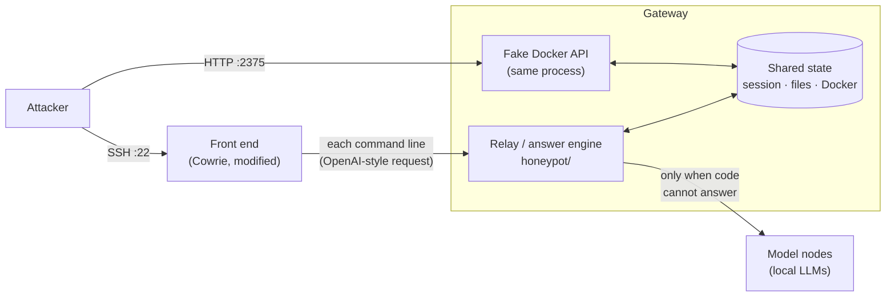
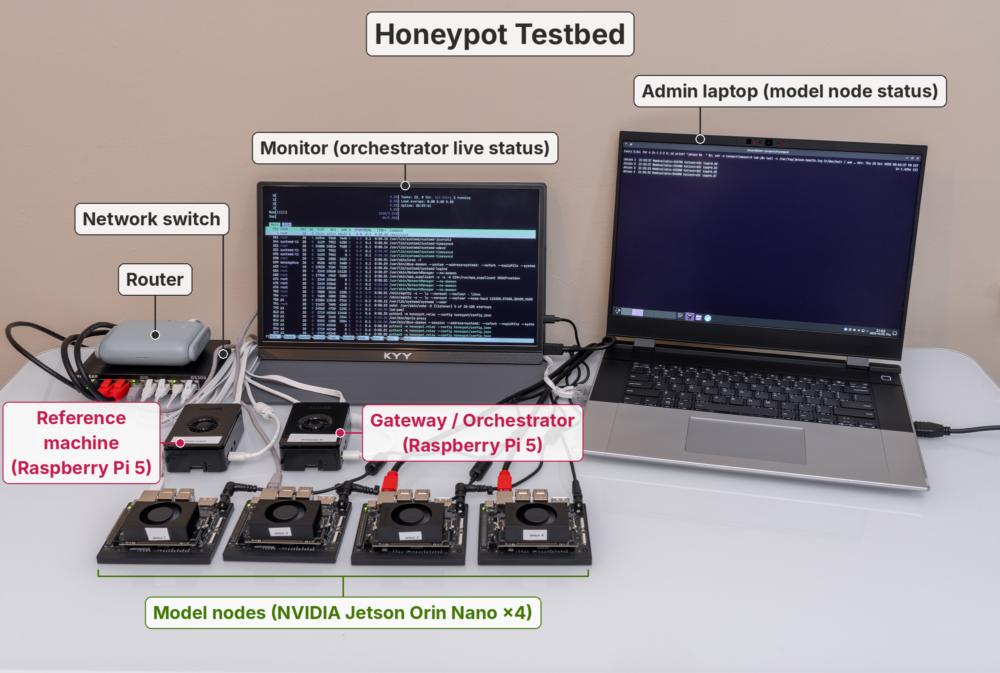

# LLM SSH honeypot with an emulated Docker API

An SSH honeypot that imitates **one specific real machine**, and is measured against it.

The real machine (the *reference machine*) is a small home-sensor box: a Raspberry Pi
running a Docker Compose stack (MQTT broker → Node-RED → InfluxDB). We recorded how it
answers hundreds of shell commands and Docker API requests. The honeypot answers every
command either **in code**, from its own simulated state, or with a **local language
model**, and each answer is scored against the real machine's recording, not judged by
eye for "looks real".

The honeypot also fakes an exposed **Docker Engine API** on the same simulated machine.
The shell's `docker` commands and the API read and change **one shared state**, so
`docker ps` in the shell and `GET /containers/json` on the API always agree, including
after an attacker creates, starts or removes a container on either side.

> This repository holds the code. The recordings of the reference machine, the training
> data and the measured results are not included (see [What is not here](#what-is-not-here)).

---

## How it works



1. **Front end.** A modified [Cowrie](https://github.com/cowrie/cowrie) handles SSH:
   banner, key exchange, password check, terminal. It forwards *every* command line to
   the relay, including ones Cowrie would normally answer itself.
2. **Relay (answer engine).** Decides how each command is answered and keeps all state:
   working directory, variables, history, files the attacker created, and the Docker
   state. It speaks plain OpenAI chat completions with one extra field
   ([`docs/relay-protocol.md`](docs/relay-protocol.md)).
3. **Code answers.** Anything that can be computed exactly is computed: identity and
   network commands, `ls` in GNU's column layout, `/proc` and `/sys` files, bash's own
   parsing (unfinished lines, globbing, quoting, `printf`, arithmetic, here-documents),
   and **every read-only `docker` subcommand with all its flags**. The `docker` CLI
   path calls the fake API in-process exactly as the real client would and formats the
   reply the way the client does, which is why the two surfaces cannot disagree.
4. **Model answers.** What is left goes to a small local model on one of several model
   nodes, shown recorded answers of similar commands as examples. The relay spreads load
   across nodes, marks a failed node down until it answers again, cuts runaway output,
   and stops generation on Ctrl-C.
5. **Fake Docker API.** Answers only from the shared state, never from a real daemon.
   It reproduces details clients rely on, such as the multiplexed log-stream framing and
   the daemon's merge rules for `POST /containers/create`.

### Design rules

- **No replay of stored answers.** Looking up the command text and returning a
  recording would be a hash-table cache, not a honeypot. That path exists only behind a
  config flag (`replay_tier`) that stays off. Recordings are used as the model's
  examples and as fine-tuning data.
- **No real Docker.** The honeypot must never proxy to, or expose, a real Docker
  daemon; `tests/test_docker_api.py` guards this.
- **Code vs. model is switchable.** Each category moved from the model to code has its
  own switch (`code_scope` in the config), so the split can be measured both ways.
- **Standard library only** for the relay, so it deploys by `rsync` to a bare gateway.

### Details that give a honeypot away (and that this one reproduces)

- The gateway's own IP, MAC and IPv6 in `ip a`, `ifconfig`, routes and `env`, never the
  reference machine's (which appear in the recordings the model sees).
- Time-zone labels that match the moment shown, across a daylight-saving change
  (a September file still shows `-0400` in November).
- A volatile journal: `journalctl -b -1` gives the exact "no persistent journal" error.
- Docker container logs as an 8-byte-header multiplexed stream, not plain text.
- The same credentials in a container's environment whether read through the API or
  through `docker inspect` in the shell.
- The reference machine's SSH algorithm lists, strict key exchange and extension
  message, so a pre-login scan looks the same on both machines.

---

## Testbed



The reference machine and the gateway are two identical Raspberry Pi 5 boards; the model
nodes are NVIDIA Jetson Orin Nano boards. Everything sits on an isolated lab network
without Internet access.

---

## Repository layout

| Path | What it is |
|---|---|
| [`honeypot/`](honeypot/) | The relay and the fake Docker API. `relay.py` (entry point), `shell.py` (command handling), `dockercli.py` / `dockerapi.py` / `docker.py` (CLI, API, shared Docker state), `backend.py` (model nodes), `config.json` (configuration; the `_..._comment` fields explain the less obvious keys). |
| [`cowrie/`](cowrie/) | The SSH front end: Cowrie (upstream `ddd97e97`) with relay routing, the reference machine's SSH algorithms, strict key exchange, the extension message, ping and Ctrl-C forwarding. |
| [`tests/`](tests/) | Relay tests. `tests/fixtures/` holds outputs of the real Docker client and of real bash, recorded in an arm64 Debian userland, which the code answers must match byte for byte. |
| [`tools/`](tools/) | Measurement, checking and data-building tools (each file's docstring says how to run it). [`tools/finetune/`](tools/finetune/) has the LoRA / QLoRA / DoRA fine-tuning and evaluation scripts for a GPU machine. |
| [`scripts/`](scripts/) | Deploying the relay, preparing model nodes, the paced measurement run and the end-to-end rehearsal. |
| [`deploy/systemd/`](deploy/systemd/) | Service files for the relay and Cowrie. |
| [`docs/relay-protocol.md`](docs/relay-protocol.md) | The protocol between the front end and the relay. |
| `eval_scorer.py`, `eval_honeypot.py` | The scorer: compares the honeypot's answers with the reference machine's. |
| `capture_session_v3.py` | Records shell answers over SSH, one fresh login per command. |
| `site.example.json` | Made-up stand-ins for every site-specific value (next section). |

Comments in the code sometimes cite requirement numbers (R1–R28) or design notes under
`docs/`; those notes are internal to the project and not part of this repository.

---

## Quick start

Needs Python 3.13 or newer. The relay and its tests use only the standard library.

**Run the tests:**

```bash
python3 -m unittest discover -s tests
```

On a fresh clone, tests that compare against the reference machine's recordings are
**skipped**, each naming the recording it needs; everything else runs.

**Run the relay without a lab** (code answers work; model answers need a model node):

```bash
python3 -m honeypot.relay --config honeypot/config.json --example-site
```

**Cowrie's own tests** run inside `cowrie/` in a separate virtual environment
(see `cowrie/INSTALL.rst`).

---

## Site values

Nothing site-specific is in the code: lab addresses and MACs, the credentials the
simulated machine serves, and the names of the development machine. Code and data hold
`@@name@@` placeholders, and [`honeypot/site.py`](honeypot/site.py) fills them from:

- **`site.local.json`** at the repository root, if present: the real values. It is
  git-ignored and never committed.
- **`site.example.json`** otherwise: made-up values, each **the same length** as the
  real one, so column widths and stream-frame lengths stay consistent either way.

To run against your own lab, copy the example to `site.local.json` and fill in your
values. The relay refuses to start on the example values unless you pass
`--example-site`, so a deployment can't serve made-up values by accident.

---

## What is not here

- The recordings of the reference machine, the retrieval corpus, and anything built from
  them (training data, fine-tuned models). They contain the machine's password hashes and
  service credentials.
- Measurement run files, logs and relay state.
- The paper.

A check, [`tools/publish_check.sh`](tools/publish_check.sh), runs before every update of
this repository. It lists exactly what would be published and stops if any file holds a
real site value, a lab address, a password hash, a private key or a developer's home path.

## Contributing

Work on a branch and open a pull request into `main`. Changes to the front end stay
inside `cowrie/`; a change to the relay protocol is agreed first, since both sides
implement it. Never commit any of the items listed above.

## License

`cowrie/` is Cowrie's own code and keeps its license
([BSD-3-Clause](cowrie/LICENSE.rst), with its vendored JA4 code under
[FoxIO 1.1](cowrie/LICENSES/LicenseRef-FoxIO-1.1.txt)).
